> [!CAUTION]
> **RESEARCH EXPERIMENTATION & LIABILITY DISCLAIMER**  
> This software is purely research experimentation and is provided strictly **"AS IS"**. It may damage your device, CNC machine, spindle, laser diode, workpiece, or computer. The goal of this project is the exploration of what is possible in unified in-browser digital fabrication. Users accept all risks and agree to hold authors, contributors, and developers completely harmless regardless of outcome. **USE AT YOUR OWN RISK.**
>
> All comments, feedback, and discussion are encouraged and welcome in community posts.  
> **Community Rules:**
> 1. **Open Source & Copyleft:** Keep all innovations accessible and free for everyone.
> 2. **Constructive Community:** Keep all commentary positive, helpful, and respectful.
> 3. **Action-Oriented Collaboration:** Write code to fix issues and share your solutions back to the group.

---

# JSVCLE Studio — Developer Guide
**JumpStart 3D CAD + Vellum Vector Studio + Continuous Layer Extension (CLE)**  
*Architecture, Subsystem Internals, Lifecycle, API Reference, and Tooling Manual*

---

## 1. System Architecture & High-Level Design

### 1.1 Architectural Overview
JSVCLE Studio is a modular digital fabrication platform combining three core runtime environments into an integrated desktop architecture:
1. **JumpStart 3D CAD Core (`Dev/index.htm`)**: An in-browser Boundary Representation (B-Rep) parametric solid modeling engine built on Three.js and custom geometric kernel primitives.
2. **Vellum Vector Studio (`Vellum/index.htm`)**: A standalone 2D parametric vector editor, SVG engine, and laser path generator running within an isolated or modal iframe context.
3. **Continuous Layer Extension (CLE) (`Dev/cle_tools/`)**: A modular suite of ES6 classes mounted directly into JumpStart's runtime lifecycle to provide CNC/laser toolpath slicing, physical machine envelope simulation, 4th axis rotary modeling, dual-mode gamepad control, hardware telemetry, and job recovery.
4. **Local Hardware & Git Vault Service (`tools/CLE_server.py`)**: A zero-dependency Python 3 HTTP daemon listening on `127.0.0.1:8765` providing CLE Git snapshotting, controller profile persistence, and PrusaSlicer CLI execution fallback.


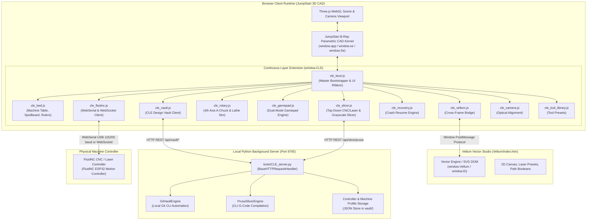

---

### 1.2 Repository Structure & Component Hierarchy


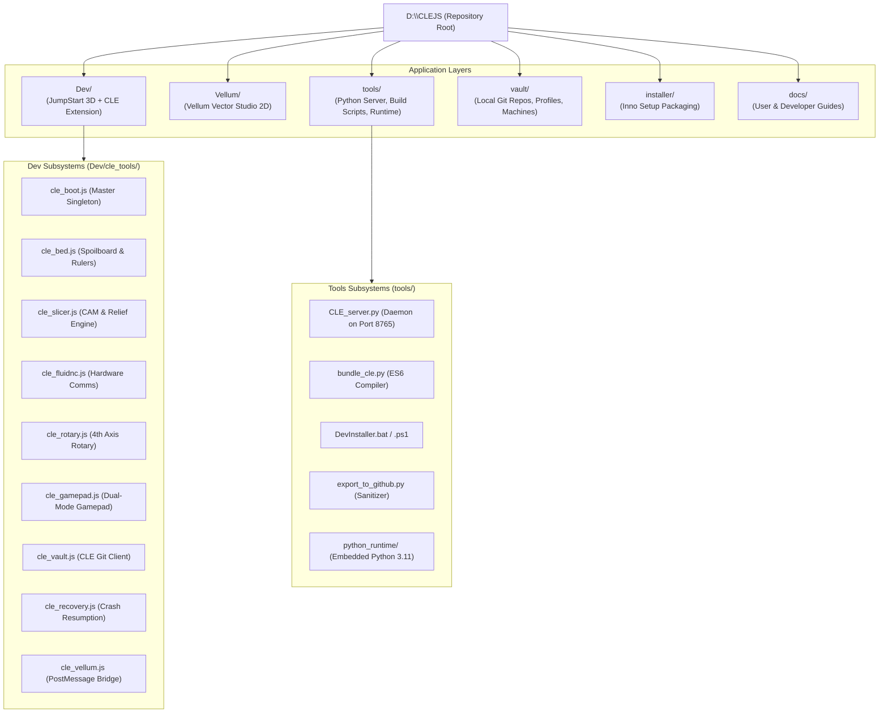

---

## 2. Functional Capability Model

JSVCLE operates under a unified functional capability matrix across CAD, CAM, 2D Vector, and CNC control domains:

---

## 3. Development Environment & DevInstaller

The JSVCLE build and development infrastructure is designed for zero friction on Windows 11 64-bit developer workstations.

### 3.1 Toolchain Verification Hierarchy


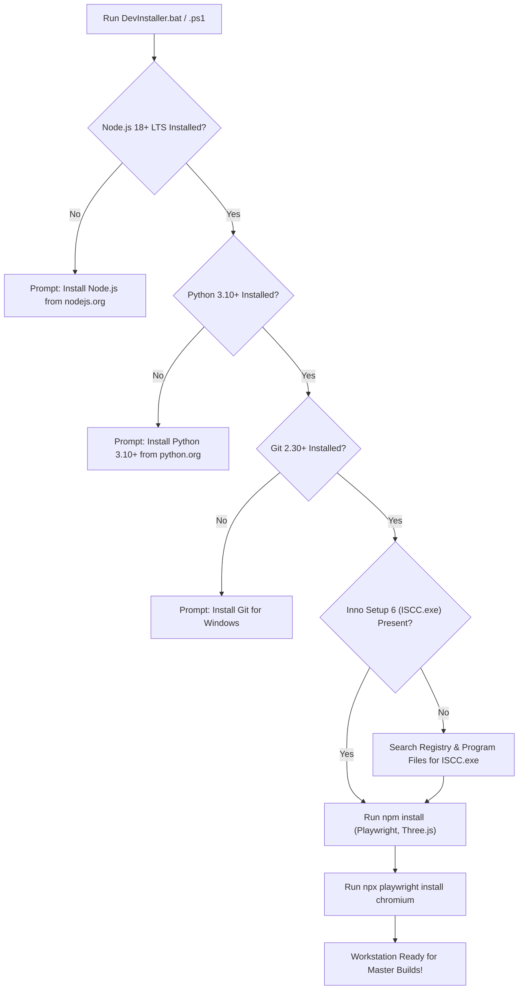

### 3.2 Master Build Pipeline (`build_full_tree.bat` / `Build-FullTree.ps1`)

The master build script automates a 6-stage release pipeline:

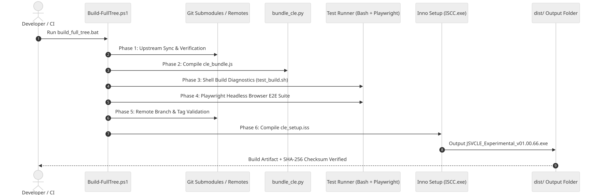

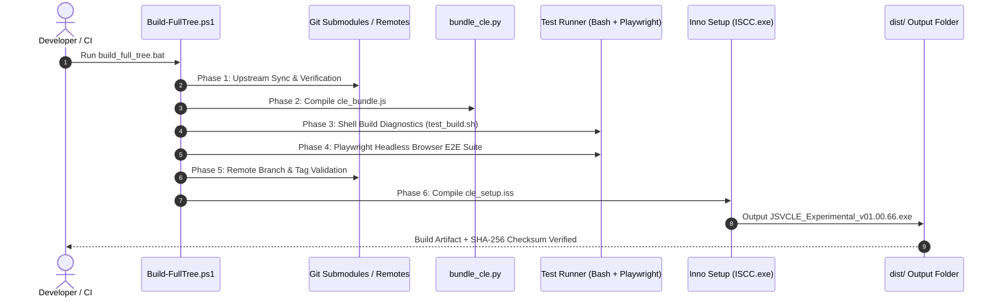

---

## 4. File-by-File Breakdown & Module Reference


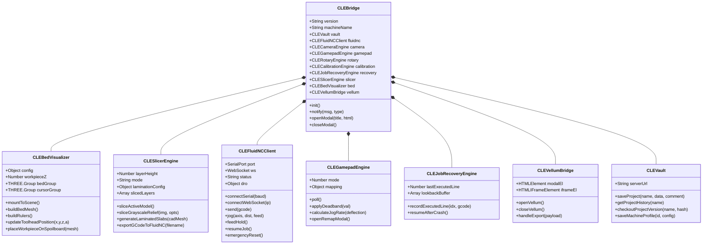

### 4.1 Master Bootstrap & UI Lifecycle: `Dev/cle_tools/cle_boot.js`
- **Role**: Master orchestrator. Instantiates all sub-engines, builds top navigation tabs, injects the ribbon UI, manages modal dialogs, and controls DOM toasts.
- **Global Exports**:
  - `window.CLE`: Master instance of `CLEBridge`.
- **Key Methods**:
  - `init()`: Lifecycle hook executed on `DOMContentLoaded`. Mounts CSS, builds UI ribbon, initializes bed visualizer, attaches keyboard hooks, and pings `CLE_server.py`.
  - `injectStyles()`: Appends `cle_theme.css` styles into the JumpStart host DOM.
  - `buildTopNavigationTabs()`: Appends `CAD | CAM | Laser | Rotary | Slicer | Vellum` workspace selector tabs to the top header.
  - `buildRibbon()`: Renders contextual action bars (Connection, Jog Controls, Spoilboard, Slicer, Rotary, Vault).
  - `showVaultSaveNotice(msg)`: Displays animated non-blocking HUD notification.
  - `openModal(title, contentHtml)` / `closeModal()`: Standardized modal dialog manager.

### 4.2 Spoilboard, Machine Table & Rulers: `Dev/cle_tools/cle_bed.js`
- **Role**: Renders the physical CNC workspace in Three.js, including MDF spoilboard, extruded aluminum base frame, precision millimeter ruler graduations, workpiece seating, and the live 4-axis toolhead cursor.
- **Class**: `CLEBedVisualizer(bridge)`
- **Key Properties**:
  - `config.travelX`, `config.travelY`, `config.travelZ`: Active machine envelope dimensions ($600 \times 500 \times 100\,\text{mm}$).
  - `config.spoilboardThickness`: MDF slab thickness (default $20.0\,\text{mm}$).
  - `config.cutoutOvercut`: Safe breakthrough allowance into spoilboard (default $0.2\,\text{mm}$).
  - `workpieceZ`: Calculated top-of-spoilboard seating height ($Z = \text{thickness} + 0.1\,\text{mm} = 20.10\,\text{mm}$).
  - `bedGroup`: `THREE.Group` containing table meshes and grid lines.
  - `cursorGroup`: `THREE.Group` containing live spindle cone, tool tip, projected shadow reticle, and DRO billboard.
- **Key Methods**:
  - `mountToScene()`: Hooks into JumpStart's active Three.js scene (`window.app.scene` or `window.xe.scene`).
  - `buildBedMesh()`: Generates aluminum bed frame and textured MDF spoilboard.
  - `buildRulers()`: Generates millimeter graduations and numeric labels along X (0 to 600mm) and Y (0 to 500mm) using canvas texture sprites.
  - `updateToolheadPosition(x, y, z, a)`: Moves live 3D cursor, casts vertical shadow down onto spoilboard surface, and updates floating DRO coordinate tag.
  - `placeWorkpieceOnSpoilboard(mesh)`: Aligns bottom bounding box of CAD solid or grayscale relief to `Z = workpieceZ`.

### 4.3 Slicer & Toolpath Engine: `Dev/cle_tools/cle_slicer.js`
- **Role**: Multi-mode CNC, Laser, and 3D slicing engine. Converts B-Rep solids, meshes, and 2D grayscale relief depth maps into multi-pass G-code.
- **Class**: `CLESlicerEngine(bridge)`
- **Key Modes**:
  - `mode = 'cnc'`: Top-Down roughing and finishing passes ($Z_{\max} \rightarrow Z_{\min}$) down to spoilboard overcut.
  - `mode = 'laser'`: Top-down planar vector marking and vector rastering.
  - `mode = '3d'`: Bottom-up additive FDM slicing ($Z_0 \rightarrow Z_{\max}$).
  - `laminationConfig.enabled = true`: Laminated slicing for biradial horns and thick slab stock. Partitions tall models into discrete slabs (e.g. $30.0\,\text{mm}$) with automated $\varnothing 8.0\,\text{mm}$ alignment dowel holes.
  - `sliceGrayscaleRelief(imageEl, options)`: Creates 3D continuous relief mesh from grayscale image brightness and computes carving toolpath.
- **Key Methods**:
  - `sliceActiveModel()`: Inspects JumpStart CAD geometry, extracts planar boundary contours, computes infill hatch, and renders 3D layer visualization stack.
  - `generateLaminatedSlabs(cadMesh)`: Splits geometry along Z planes into separate machining jobs with registration pins.
  - `renderLayerStack()`: Generates color-coded `THREE.LineSegments` representing rapid moves (red), feed moves (cyan), and retracts (yellow).
  - `exportGCodeToFluidNC(filename)`: Sends generated toolpath over HTTP to `CLE_server.py` or streams to FluidNC SD card.

### 4.4 Hardware Comms & FluidNC Client: `Dev/cle_tools/cle_fluidnc.js`
- **Role**: Communicates with physical CNC/Laser controller hardware via WebSerial API (USB) and WebSocket (Wi-Fi).
- **Class**: `CLEFluidNCClient(bridge)`
- **Key Properties**:
  - `port`: Active `SerialPort` instance.
  - `ws`: Active `WebSocket` instance.
  - `status`: Machine status string (`Idle`, `Run`, `Jog`, `Hold`, `Alarm`).
  - `dro`: Machine coordinates `{ X, Y, Z, A }` and work coordinates `{ wX, wY, wZ, wA }`.
- **Key Methods**:
  - `connectSerial(baudRate = 115200)`: Requests WebSerial USB device and opens reader/writer streams.
  - `connectWebSocket(ipAddress)`: Connects to FluidNC WebSocket stream on port 81 or 8080.
  - `send(gcodeLine)`: Queues and transmits G-code command string.
  - `jog(axis, distance, feedRate)`: Sends real-time jog string `$J=G91 G21 {axis}{distance} F{feedRate}`.
  - `feedHold()`: Sends immediate `!` character.
  - `resumeJob()`: Sends immediate `~` character.
  - `emergencyReset()`: Sends immediate Ctrl+X (`\x18`) character.
  - `pollStatus()`: Sends `?` query every $100\,\text{ms}$ to parse `<Status|WPos:X,Y,Z,A|FS:feed,speed>` responses.

### 4.5 Dual-Mode Gamepad Engine: `Dev/cle_tools/cle_gamepad.js`
- **Role**: Connects USB/Bluetooth gamepads (Nintendo Switch Pro, Xbox, PlayStation) with dual-mode behavior.
- **Class**: `CLEGamepadEngine(bridge)`
- **Operational Modes**:
  - `Mode 0: Design CAD Mode`: Left stick orbits CAD camera; right stick pans; triggers zoom in/out.
  - `Mode 1: CNC Machine Jog Mode`: Left stick jogs X/Y axes; right stick jogs Z axis; bumpers jog A rotary axis.
- **Key Methods**:
  - `poll()`: High-frequency loop synchronized to `requestAnimationFrame`.
  - `applyDeadband(value, threshold = 0.12)`: Filters joystick analog drift.
  - `calculateJogRate(axisDeflection)`: Applies quadratic acceleration curve for precise micro-stepping on soft deflections and high-speed transit on full deflections.
  - `openRemapModal()`: Opens visual remap interface for button and axis reassignment.

### 4.6 4th Axis Rotary (A) & Lathe: `Dev/cle_tools/cle_rotary.js`
- **Role**: Simulates and toolpaths continuous 4th axis rotary operations.
- **Class**: `CLERotaryEngine(bridge)`
- **Key Properties**:
  - `chuckDiameter`: Visual 3-jaw chuck diameter (default $80\,\text{mm}$ or $100\,\text{mm}$).
  - `stockLength`, `stockDiameter`: Visual cylinder stock dimensions.
  - `rotaryGroup`: `THREE.Group` attached to machine bed.
- **Key Methods**:
  - `mountToBed()`: Positions rotary chuck along the left edge of the spoilboard ($X=50\,\text{mm}, Y=250\,\text{mm}, Z=60\,\text{mm}$).
  - `updateAngle(deg)`: Continuously rotates chuck, jaws, and stock cylinder in 3D viewport.
  - `clampWorkpiece(length, diameter)`: Adjusts 3D stock cylinder dimensions and centers on lathe axis.

### 4.7 CLE Design Vault Client: `Dev/cle_tools/cle_vault.js`
- **Role**: Frontend client communicating with `tools/CLE_server.py` to provide version control and profile persistence.
- **Class**: `CLEVault(bridge)`
- **Key Methods**:
  - `saveProject(projectName, cadStateJson, comment)`: Posts project bundle to `/api/vault/save`. Triggers automatic Git commit in `vault/projects/{name}/`.
  - `getProjectHistory(projectName)`: Fetches commit hash, author, timestamp, and message log.
  - `checkoutProjectVersion(projectName, commitHash)`: Restores exact historical project state.
  - `saveControllerProfile(profileName, mapping)`: Saves gamepad mapping to `vault/profiles/`.
  - `saveMachineProfile(machineId, config)`: Saves machine envelope, limits, and bed offsets to `vault/machines/`.

### 4.8 Vellum Vector Studio Bridge: `Dev/cle_tools/cle_vellum.js`
- **Role**: Bi-directional integration bridge between JumpStart 3D and ClassyApps Vellum Vector Studio.
- **Class**: `CLEVellumBridge(bridge)`
- **Key Properties**:
  - `modalEl`: Fullscreen overlay container.
  - `iframeEl`: Embedded iframe hosting `Vellum/index.htm`.
- **Key Methods**:
  - `openVellum()` / `closeVellum()`: Toggles fullscreen Vellum workspace overlay.
  - `initMessageListener()`: Listens for `window.addEventListener('message')` events containing `CLE_VELLUM_EXPORT`.
  - `handleExport(payload)`: Receives vector data from Vellum:
    - **Option 1 (New Sketch)**: Injects 2D curve into JumpStart as an editable sketch on the active plane.
    - **Option 2 (Direct Extrude)**: Invokes JumpStart's CAD kernel to extrude the closed vector boundary into a 3D solid at specified thickness (e.g. $5.0\,\text{mm}$).
    - **Option 3 (Bed Image Overlay)**: Embeds vector silhouette onto the CNC spoilboard table for alignment.

### 4.9 Local Hardware & Git Vault Server: `tools/CLE_server.py`
- **Role**: Python 3 HTTP daemon on `127.0.0.1:8765`. Standard library only (`http.server`, `subprocess`, `json`, `pathlib`).
- **Classes**:
  - `GitVaultEngine`: Automates `git init`, `git add`, `git commit`, `git log`, and `git checkout` inside `vault/projects/{name}/`.
  - `PrusaSlicerEngine`: CLI wrapper executing bundled or system PrusaSlicer binary to export sliced G-code.
  - `CLEVaultHandler(BaseHTTPRequestHandler)`: REST endpoint dispatcher with CORS support.
- **API Endpoints**:
  - `GET /api/status`: Returns server health, active port, and Git binary path.
  - `POST /api/vault/save`: Receives `{ project, json_data, comment }` $\rightarrow$ writes `model.json` $\rightarrow$ Git commit.
  - `GET /api/vault/history?project={name}`: Returns Git commit history array.
  - `POST /api/vault/checkout`: Receives `{ project, hash }` $\rightarrow$ runs `git checkout {hash}` $\rightarrow$ returns restored JSON.
  - `POST /api/profile/save` & `GET /api/profile/list`: Manages gamepad mappings in `vault/profiles/`.
  - `POST /api/machine/save` & `GET /api/machine/list`: Manages machine configurations in `vault/machines/`.
  - `POST /api/slice/prusa`: Accepts STL or geometry payload $\rightarrow$ runs PrusaSlicer CLI $\rightarrow$ returns G-code.

---

## 5. Execution Flow, Lifecycles & Event Architecture

### 5.1 System Initialization Lifecycle

When `Dev/index.htm` is loaded, JSVCLE initializes through 4 deterministic phases:

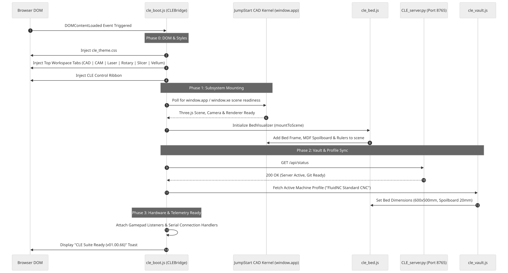

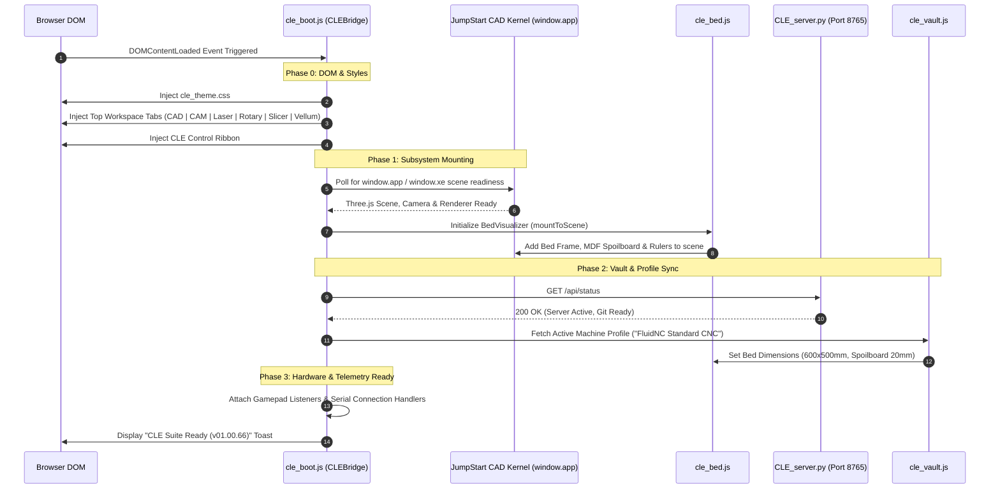

---

### 5.2 Slicer Toolpath Generation & G-Code Export Execution Flow


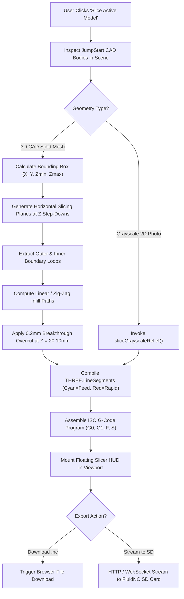

---

### 5.3 Grayscale 2D Photo to 3D Continuous Z Relief Carving Flow

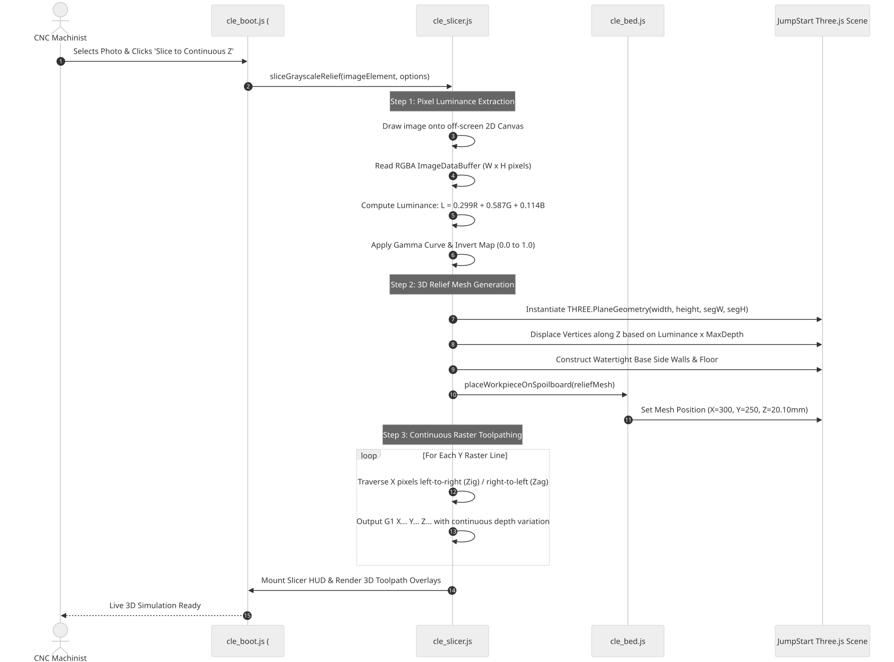

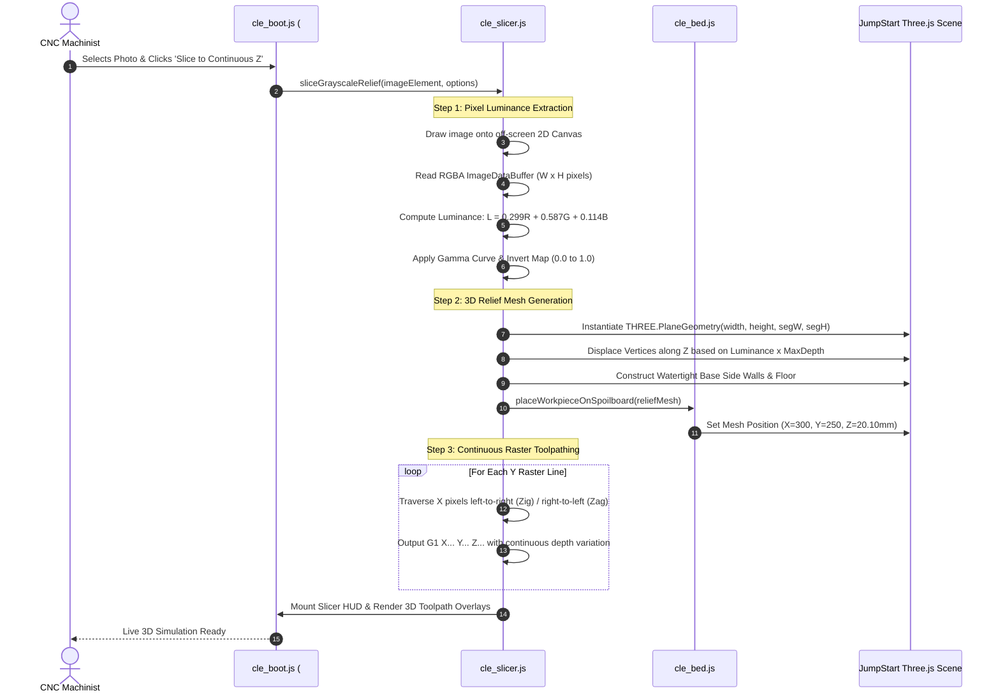

---

### 5.4 Hardware Telemetry, Real-Time DRO & Jogging Execution Flow

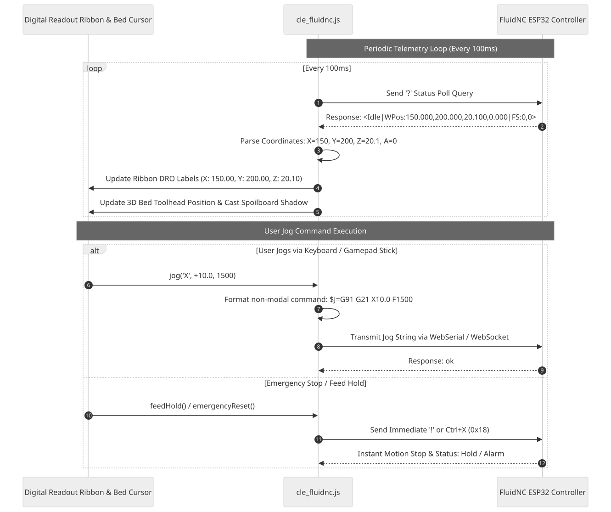

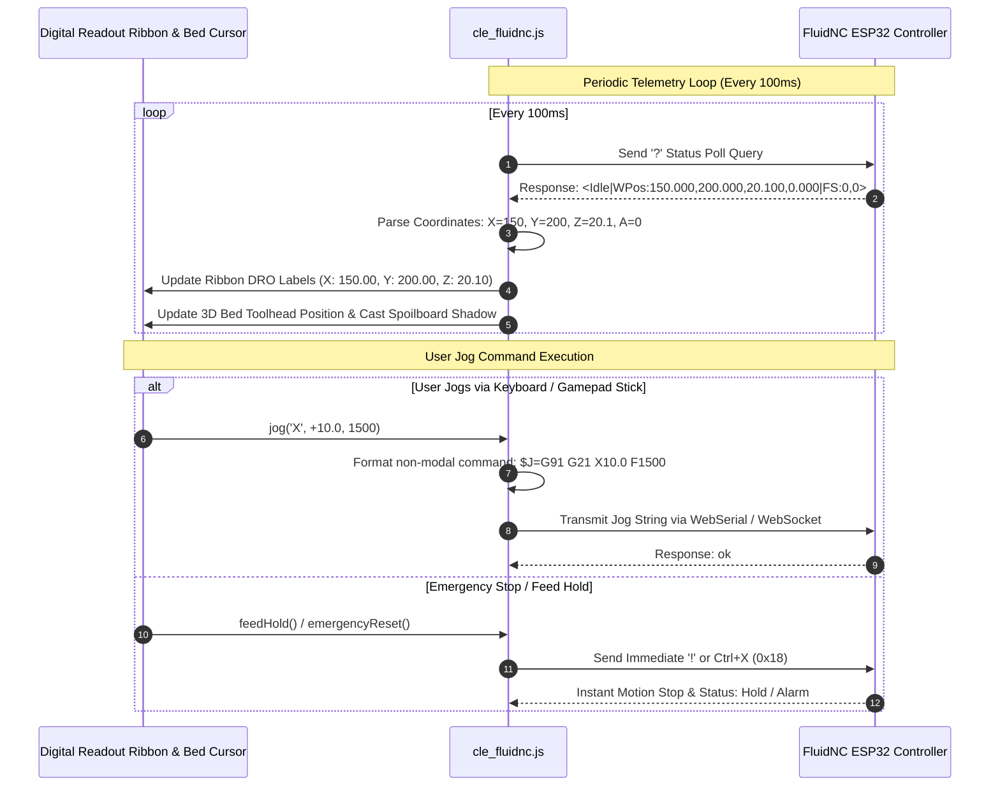

---

### 5.5 Job Crash Recovery with Lookback Buffer Execution Flow


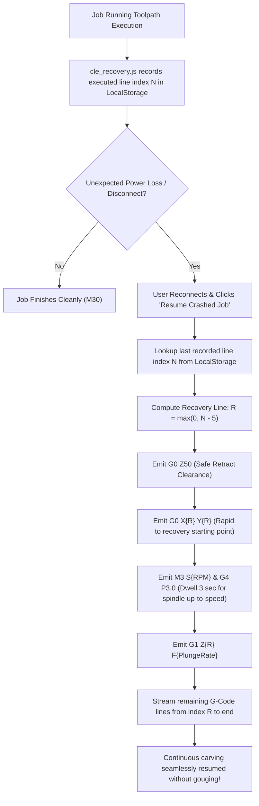

---

### 5.6 CLE Git Vault Project State Snapshot & Restoration Flow

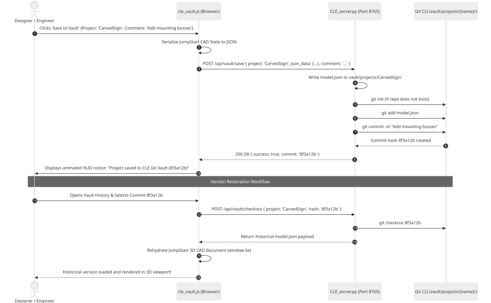

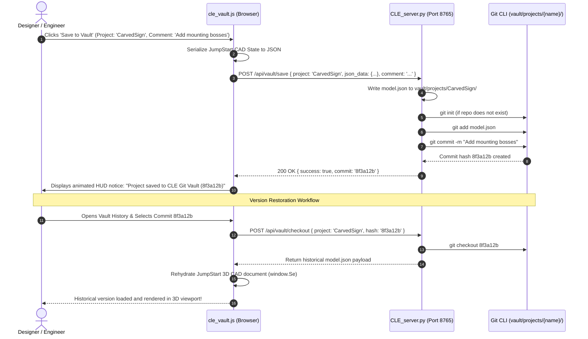

---

## 6. Window Global Namespaces Reference

| Global Identifier | Providing Module | Description |
|---|---|---|
| `window.CLE` | `Dev/cle_tools/cle_boot.js` | Master singleton instance of `CLEBridge`. Houses references to all sub-engines (`CLE.bed`, `CLE.slicer`, `CLE.fluidnc`, `CLE.rotary`, `CLE.gamepad`, `CLE.vault`, `CLE.vellum`, `CLE.recovery`). |
| `window.app` / `window.xe` | JumpStart CAD Core (`Dev/index.htm`) | Master JumpStart application instance. Manages Three.js scene (`app.scene`), active camera (`app.camera`), renderer, B-Rep bodies, and command stack. |
| `window.Se` | JumpStart CAD Core | CAD document model containing active sketches, parametric features, planes, and solid bodies. |
| `window.Ei` | Vellum Core (`Vellum/index.htm`) | Vellum application instance managing 2D SVG canvas elements, layers, selection sets, and vector export pipelines. |
| `window.Vellum` | Vellum Core | Vellum standalone API namespace for curve generation and laser kerf calculation. |

---

## 7. Glossary of Functions, Classes & Technical Terms

### Technical Classes & Methods

- `CLEBridge`: The central controller class instantiated at `window.CLE`. Aggregates all subsystems and coordinates UI lifecycle.
- `CLEBedVisualizer.mountToScene()`: Binds the CNC table, MDF spoilboard, and millimeter graduation rulers into JumpStart's active Three.js scene hierarchy.
- `CLEBedVisualizer.placeWorkpieceOnSpoilboard(mesh)`: Analyzes the bounding box of a 3D CAD mesh or relief mesh and translates its Z-origin so the bottom rests exactly at $Z = 20.10\,\text{mm}$ (spoilboard surface + safe clearance).
- `CLESlicerEngine.sliceActiveModel()`: Traverses the active solid body, intersects slicing planes along the Z-axis, generates contour boundaries, calculates infill paths, and compiles CNC/laser G-code.
- `CLESlicerEngine.generateLaminatedSlabs(cadMesh)`: Partitions tall CAD models into horizontal $30\,\text{mm}$ slab layers with dowel pin registration holes for laminated acoustic horns.
- `CLEFluidNCClient.jog(axis, distance, feedRate)`: Formats and sends non-modal GRBL jog commands (`$J=G91 G21 ...`) via USB Serial or WebSocket.
- `CLEJobRecoveryEngine.recordExecutedLine(lineNumber, gcodeStr)`: Circular buffer tracking executed toolpath lines in browser local storage.
- `CLEJobRecoveryEngine.resumeAfterCrash()`: Reads crash line index, backs up 5 lines (`-5` lookback), raises spindle to safe Z clearance, moves to XY restart point, spins up spindle, and resumes carving.
- `CLEGamepadEngine.calculateJogRate(axisDeflection)`: Mathematical transfer function applying quadratic scaling $f(x) = \text{sign}(x) \cdot x^2 \cdot V_{\max}$ for smooth jog speed control.
- `GitVaultEngine.ensure_repo(projectDir)`: Backend Python method that validates the presence of `.git` in a project vault directory, initializing an isolated Git repository if absent.
- `CLEVellumBridge.handleExport(payload)`: Message handler parsing vector payloads exported from Vellum Vector Studio into JumpStart CAD geometry.

### Engineering & Domain Terms

- **B-Rep (Boundary Representation)**: The method used by CAD kernels to represent 3D solid objects by their enclosing boundary surfaces (faces, edges, vertices).
- **Continuous Z Relief**: Converting a continuous 2D grayscale image (0–255 pixel intensity) into continuous toolhead depth coordinates for 3D sculptural carving.
- **DRO (Digital Readout)**: Real-time numeric display of the toolhead's current coordinates across X, Y, Z, and A axes in millimeters and degrees.
- **FluidNC**: High-performance, open-source CNC firmware running on ESP32 microcontrollers supporting multi-axis motion, USB serial, and Wi-Fi WebSockets.
- **Laminated Slicing**: Slicing thick or curved objects (such as acoustic loudspeaker horns) into separate wood slab layers that are machined independently and aligned using dowel pins.
- **CLE Git Vault**: An architectural pattern where every machine configuration, tool library change, and CAD model revision is automatically committed to a local, zero-network Git repository.
- **Lookback Buffer (`-5` lines)**: Crash recovery strategy where resume execution starts 5 toolpath lines prior to the recorded crash point, ensuring smooth overlap without leaving uncarved gouges or ridges.
- **Spoilboard**: A sacrificial MDF board mounted to the aluminum CNC bed table, allowing cutting tools to cleanly break through workpieces without damaging the machine frame.
- **WebSerial API**: Modern browser W3C standard allowing web applications to directly read and write to serial COM ports at baud rates up to 115200 without browser plugins.
