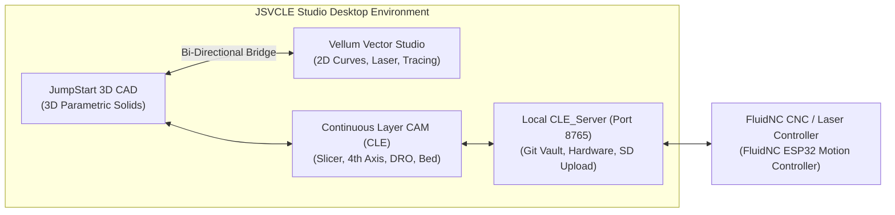
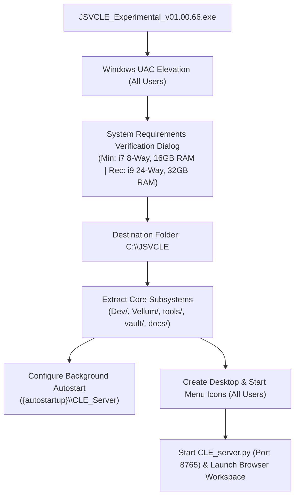
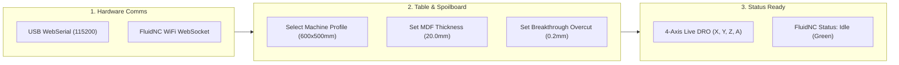
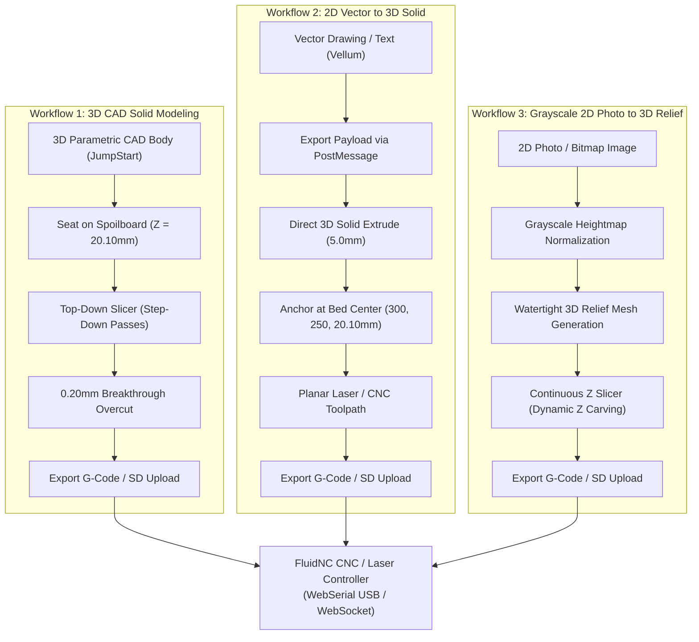

> [!CAUTION]
> **RESEARCH EXPERIMENTATION & LIABILITY DISCLAIMER**  
> This software is purely research experimentation and is provided strictly **"AS IS"**. It may damage your device, CNC machine, spindle, laser diode, workpiece, or computer. The goal of this project is the exploration of what is possible in unified in-browser digital fabrication. Users accept all risks and agree to hold authors, contributors, and developers completely harmless regardless of outcome. **USE AT YOUR OWN RISK.**
>
> All comments, feedback, and discussion are encouraged and welcome in community posts.  
> **Community Rules:**
> 1. **Open Source & Copyleft:** Keep all innovations accessible and free for everyone.
> 2. **Constructive Community:** Keep all commentary positive, helpful, and respectful.
> 3. **Action-Oriented Collaboration:** Write code to fix issues and share your solutions back to the group.

---

# JSVCLE Studio — User Guide
**JumpStart 3D CAD + Vellum Vector Studio + Continuous Layer Extension (CLE)**  
*Version 01.00.66 — Windows 11 Edition*

---

## 1. Overview: What is JSVCLE Studio?

**JSVCLE Studio** is a unified, all-in-one digital fabrication workspace designed for makers, CNC machinists, woodworkers, and laser engravers. It combines three powerful engineering applications into a single synchronized desktop environment:

1. **JumpStart 3D CAD (`Dev/index.htm`)**: An intuitive, precision boundary-representation (B-Rep) 3D parametric CAD modeling application for mechanical design, solids, extrusions, revolving, and Boolean operations.
2. **Vellum Vector Studio (`Vellum/index.htm`)**: A dedicated 2D vector graphic and laser studio featuring curve drawing, text formatting, path booleans, DXF/SVG import/export, and automatic raster-to-vector tracing.
3. **Continuous Layer Extension (CLE)**: A real-time CAM, multi-axis machine control, and slicing suite directly integrated into JumpStart 3D. CLE features:
   - **Hardware Telemetry & Control:** WebSerial USB and WebSocket networking for FluidNC CNC/Laser controllers with a live 4-axis Digital Readout (DRO).
   - **Interactive Spoilboard & Bed Manager:** Visual CNC table with automatic workpiece seating, breakthrough safe margins, and click-and-drag spoilboard placement.
   - **4th Axis Rotary (A) Chuck & Center Tool:** Live visual chuck, stock cylinder, auto-clamping, and lathe turning tools.
   - **Grayscale to Continuous Z Slicer:** 2D photo-to-3D relief depth extraction with dynamic multi-axis raster toolpath generation.
   - **Machine State Git Vault:** Automatic state snapshotting and version control for machine calibration, tool libraries, and project history.







---

## 2. System Requirements

Before running the installer, ensure your workstation meets the following specifications:

| Component | Minimum Requirements | Recommended Requirements |
|---|---|---|
| **Operating System** | Windows 11 (64-bit, Version 22H2+) | Windows 11 Pro (64-bit, latest release) |
| **Processor (CPU)** | Intel Core i7 (8-Way / 8 Cores) or AMD Ryzen 7 | Intel Core i9 (24-Way / 24 Cores @ 4.0 GHz+) or AMD Ryzen 9 |
| **System Memory (RAM)** | 16 GB DDR4/DDR5 | 32 GB+ High-Speed DDR5 |
| **Storage (SSD)** | 2 GB free on High-Speed SATA/NVMe SSD | Ultra-Fast PCIe Gen 4/5 NVMe SSD |
| **Graphics (GPU)** | WebGL 2.0 compatible (Intel Iris Xe or dedicated) | NVIDIA GeForce RTX 3060+ / AMD Radeon RX 6700+ |
| **Display Resolution** | 1920 × 1080 (Full HD) | 2560 × 1440 (2K QHD) or 3840 × 2160 (4K UHD) |
| **Ports** | 1× USB 2.0/3.0 port (for CNC USB Serial communication) | USB 3.0 + Wi-Fi 6 (for FluidNC WebSocket) |

---

## 3. Installation Guide







### Step 1: Running the Setup Executable
1. Locate [`JSVCLE_Experimental_v01.00.66.exe`](file:///d:/CLEJS/dist/JSVCLE_Experimental_v01.00.66.exe) in your distribution folder or download location.
2. Double-click the `.exe` installer. If prompted by Windows User Account Control (UAC), click **Yes** to allow installation for All Users.

### Step 2: System Requirements Notice
The installer presents a **System Requirements Notice** dialog detailing the minimum (i7 8-way, 16GB RAM) and recommended (i9 24-way, 32GB RAM) specifications. Click **OK** to begin configuration.

### Step 3: Destination Location
By default, JSVCLE Studio installs to:
```
C:\JSVCLE
```
You can click **Browse...** to choose any other drive or directory on your system.

### Step 4: Installation & Background Service Setup
Click **Install**. The installer automatically extracts:
- JumpStart 3D and the CLE suite (`Dev/`)
- Vellum Vector Studio (`Vellum/`)
- Local Background Server and Embedded Python Runtime (`tools/`)
- Machine Vault and Tool Library (`vault/`)
- Comprehensive Documentation (`docs/`)
- Windows startup entries in `{autostartup}\CLE_Server` so the hardware service starts quietly whenever you log into Windows.
- Desktop and Start Menu shortcuts for all users.

### Step 5: Launching the Application
On the final wizard page, leave **Launch JSVCLE Studio** checked and click **Finish**. The background server starts automatically, and the application opens in your default browser.

---

## 4. Initial Configuration





### 4.1 Connecting to Your Machine
1. Open **JSVCLE Studio**.
2. Click the **CLE Suite** tab in the top workspace bar.
3. In the ribbon under **Connection**:
   - **USB Serial:** Click **USB List**, select your machine's COM port (e.g. `COM3` for CH340 / CP2102), and choose baud rate `115200`.
   - **WiFi / WebSocket:** If running FluidNC over Wi-Fi, click **WiFi/WS** and enter your controller's IP address (e.g. `192.168.1.150`).
4. Once connected, the top status badge will turn green: `FluidNC: Idle`.

### 4.2 Configuring the Machine Bed & Spoilboard
1. Click **Setup & Spoilboard** in the CLE ribbon.
2. Select your machine profile from the dropdown (e.g. **FluidNC Standard CNC / Laser** or custom machine profile).
3. The 3D viewport instantly renders your exact spoilboard dimensions (e.g. $600 \times 500 \times 20\,\text{mm}$ MDF), aluminum extrusion base, and live origin reticle.
4. If your spoilboard thickness differs from standard ($20.0\,\text{mm}$), enter your measured thickness in the Spoilboard dialog and click **Save to Vault**.

---

## 5. Three Real-World Usage Workflows







### Example 1: 3D CAD Solid Modeling & Continuous Layer Slicing
*Goal: Model a mechanical mounting bracket and generate a multi-pass CNC carving toolpath.*

1. **Design the 3D Part:**
   - In the **Design 3D** workspace tab, click **Box** or draw a 2D sketch and click **Extrude** (e.g., $100 \times 60 \times 15\,\text{mm}$).
   - Add mounting holes using the **Cylinder (Hole)** tool.
2. **Place on CNC Spoilboard:**
   - Switch to the **CLE Suite** tab.
   - Click the 3D body on the bed. A luminous neon cyan outline and the **Bed Placement HUD** appear.
   - Click **🎯 Center** on the HUD to position the bracket symmetrically at $(X=300, Y=250)$ on the spoilboard.
3. **Slice to Toolpaths:**
   - In the ribbon, click **Slice & 3D Stack**.
   - Select your Target Machine: **CNC Milling (Top-Down passes)**.
   - Set Layer Height (e.g. $1.5\,\text{mm}$ step-down) and Spoilboard Breakthrough ($0.20\,\text{mm}$ overcut for clean part release).
   - Click **Slice & Display in 3D Viewport**.
4. **Simulate & Export:**
   - The interactive **Slicer HUD** mounts at the bottom of the viewport.
   - Click **Play Trace** to watch the simulated toolhead carve each layer in real time.
   - Click **Export G-Code (.nc)** or **Upload to SD Card** to transfer the program directly to your machine.

---

### Example 2: 2D Vector Design in Vellum & Extrusion to 3D
*Goal: Create an artistic vector plaque in Vellum Vector Studio and transfer it into 3D CAD.*

1. **Open Vellum Vector Studio:**
   - Click the **Vector Studio** button in the CLE ribbon (or click **Vector** in the workspace tabs).
   - Vellum opens in full-screen overlay mode.
2. **Draw Vector Geometry:**
   - Use the **Pen (Curve)**, **Shape**, or **Text** tools to draw your emblem.
   - Use **Autotrace** if importing a bitmap logo (`.svg`, `.png`).
3. **Export to JS Workspace:**
   - In Vellum's top menu, click **Export** $\rightarrow$ **Save to JS Workspace...**.
   - Choose **Option 2: 3D Extruded Body (Solid)** and enter extrusion thickness (e.g. $6.0\,\text{mm}$).
   - Click **Transfer to JS Workspace**.
4. **Result:**
   - Vellum closes and returns you directly to JumpStart 3D.
   - Your vector shape is converted into a native 3D watertight solid, resting at bed center $(300, 250, 20.10\,\text{mm})$ on the spoilboard!

---

### Example 3: Grayscale Photo to 3D Relief & Continuous Z Carving
*Goal: Convert a 2D portrait photo into a carved 3D wood relief carving.*

1. **Import Image:**
   - Click **Grayscale 3D** (`#cle-r-grayscale`) in the CLE ribbon.
   - Under *Select Image Source*, choose **📁 Browse File...** (or select a photo already transferred from Vellum).
2. **Modulate Image Depth:**
   - View the live thumbnail on the preview canvas.
   - Adjust **Contrast**, **Brightness**, and **Gamma Curve** to bring out facial contours.
   - Check **Invert Grayscale** if white represents high peaks and dark represents low carving floors.
3. **Set Physical Dimensions:**
   - Width: $120.0\,\text{mm}$, Height: $90.0\,\text{mm}$.
   - Max Relief Depth: $5.0\,\text{mm}$, Base Floor: $2.0\,\text{mm}$.
4. **Choose Action:**
   - Click **📦 Create 3D Object in Workspace**: Generates a watertight solid 3D mesh (maple finish) in the CAD scene for parametric combination.
   - Click **⚡ Slice to Continuous Z**: Generates smooth multi-axis 3D carving raster toolpaths that vary $Z$ dynamically along each pass, and mounts the Slicer HUD for simulation!

---

## 6. Troubleshooting Guide

| Symptom | Probable Cause | Recommended Solution |
|---|---|---|
| **FluidNC Offline / COM Port not found** | USB cable disconnected or CH340 driver missing | Check USB connection. In Windows Device Manager, ensure the COM port shows under *Ports (COM & LPT)*. Install the CH340/CP2102 driver if needed. |
| **"CLE_server not responding" warning** | Background Python service stopped | Run `cle_server_start.bat` from your install directory (`C:\JSVCLE`). Verify that `http://127.0.0.1:8765/api/status` returns `{"status":"running"}` in your browser. |
| **3D Viewport is blank or black** | WebGL disabled or hardware acceleration off | In your browser, go to `chrome://settings/system` (or edge settings) and enable **Use graphics acceleration when available**. Verify WebGL support at `get.webgl.org`. |
| **Slices cut through the aluminum bed** | Zero point misconfigured or no spoilboard defined | Ensure your spoilboard thickness is entered correctly in the Spoilboard Setup modal ($20.0\,\text{mm}$). Never set cutout overcut greater than spoilboard thickness. |
| **Vellum "Save to JS Workspace" doesn't switch** | Browser popup or cross-frame permission blocked | JSVCLE uses standard internal frame messaging. Ensure you are launching the application via `cle_start.bat` or localhost rather than a restricted sandbox. |

---

## 7. Uninstallation

To remove JSVCLE Studio completely from your computer:

1. Open **Windows Settings** $\rightarrow$ **Apps** $\rightarrow$ **Installed Apps**.
2. Locate **JSVCLE Studio** in the list.
3. Click the three dots `...` and select **Uninstall**.
   *(Alternatively, run `C:\JSVCLE\unins000.exe` directly or click "Uninstall JSVCLE" in the Start Menu).*
4. The uninstaller removes all desktop icons, start menu folders, startup background service hooks, and application files cleanly.

---

## 8. Glossary of Terms

- **DRO (Digital Readout):** Real-time display of machine axes ($X, Y, Z, A$) in Work Coordinate System (WCS) millimeters and degrees.
- **WCS (Work Coordinate System):** The part coordinate frame (`G54`), where $(0, 0, 0)$ is set relative to your workpiece stock rather than machine limits.
- **Spoilboard:** A sacrificial MDF board mounted on top of the aluminum extrusion bed that allows through-cuts without damaging cutting tools or the machine table.
- **Continuous Z Slicing:** A 3D CAM carving strategy where the toolhead moves smoothly in $X, Y,$ and $Z$ simultaneously following natural surface height contours, avoiding stepped stair-stepping.
- **4th Axis (A-Axis):** A rotary chuck and tailstock alignment tool that replaces the spoilboard for round stock turning, fluting, and multi-sided indexing.
- **Breakthrough Pass:** A final perimeter cutout pass that cuts $0.20\,\text{mm}$ into the MDF spoilboard so parts release cleanly without tabs.
- **FluidNC:** High-performance, open-source CNC and laser motion control firmware running on ESP32 microcontrollers with WebSerial and WebSocket support.
